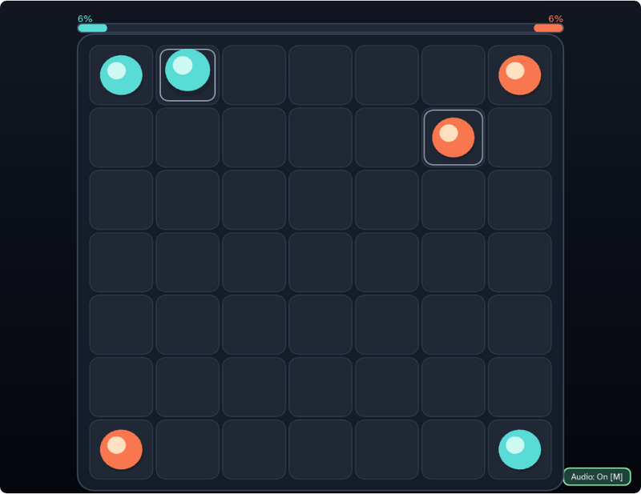

# Sporeline

A small bacteria strategy game, inspired by the bacteria puzzle from *The 7th
Guest*. It comes in two editions that share the same AI:

| | Edition | Run |
| --- | --- | --- |
| [`love/`](love/README.md) | LÖVE 11.5 version with the ambitious graphics: shaders, music, Steam Deck, web build | `make run` |
| [`pico8/`](pico8/README.md) | PICO-8 cart, 128×128, 3 sound effects | `make pico8` |

| LÖVE | PICO-8 |
| --- | --- |
|  |  |

The two AIs are **twin files**, `love/src/ai.lua` and `pico8/ai.lua`. A
"mirror match" test keeps them honest: both play the same seeded games and
must pick the same move every turn. See [MIRROR.md](MIRROR.md).

## Play both in a browser

```bash
make fetch-lovejs   # once: download the love.js runtime
make serve          # build dist/site and serve it on :8000 (PORT=9000 to change)
```

`make serve` builds one static site, `dist/site/`:

- `/`: landing page with both editions
- `/love/`: the LÖVE edition via love.js
- `/pico8/`: the cart on the **PICO-8 preview player** (`pico8/preview/`), a
  small PICO-8 stand-in written in LÖVE, also via love.js
- `/pico8-official/`: added only when the `pico8` binary is installed
  (`PICO8=/path/to/pico8`). It's the real PICO-8 HTML export.

`tools/serve.py` sends the COOP/COEP headers love.js needs. On an exe.dev VM
the site is at `https://<vm>.exe.xyz:8000/`.

## Commands (repo root)

```bash
make test     # LÖVE unit tests + mirror match + cart smoke test + token meter
              #   (same as `luajit tests/run.lua`, which is what CI runs)
make mirror   # just the LÖVE-vs-PICO-8 AI parity games
make run      # play the LÖVE edition
make pico8    # open the cart in PICO-8 (set PICO8=/path/to/pico8 if needed)
make serve    # both editions on a local web page (see above)
make appimage # LÖVE Steam Deck build → dist/ (also build, web, …)
```

Tests need `luajit`. The web build also needs `zip` and `curl`.

## Layout

```
love/        LÖVE edition (main.lua, src/, assets/, tests/, web/, build/)
pico8/       PICO-8 edition (sporeline.p8 + #included .lua files)
pico8/preview/  PICO-8 preview player (LÖVE) used for the web build
site/        landing page + PICO-8 page templates for `make site`
tests/       run.lua (runs everything), mirror_match.lua, cart_smoke.lua
tools/       pico8_env.lua (PICO-8 sandbox for LuaJIT), p8tokens.lua, serve.py
docs/        screenshots
scripts/     Steam Deck install/update helpers (see STEAMDECK.md)
MIRROR.md    how the two AIs stay in sync
```

## Rules

- Both editions play on a 7×7 board, starting with one bacterium per side in each pair of opposite corners.
- Grow: place a new bacterium in any adjacent cell (diagonals included).
- Jump: move a bacterium exactly 2 cells orthogonally, leaving the origin empty.
- After either move, adjacent enemy bacteria around the destination convert.
- Eliminate the other side to win; if nobody can move, the bigger colony wins.
- A side with no legal moves passes automatically.
