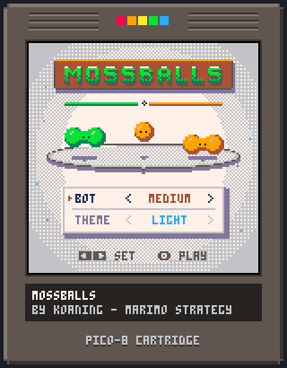
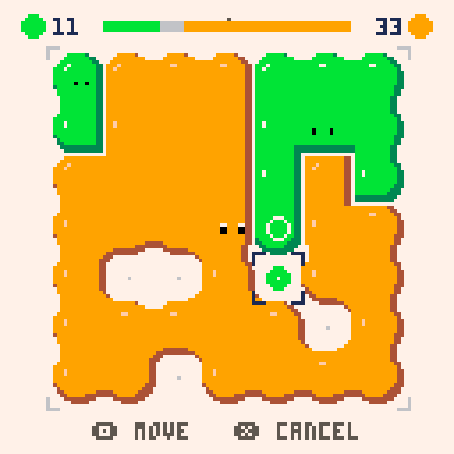

# Mossballs

A bacteria strategy game for **PICO-8** (128×128, 16 colours, 3 sound effects),
inspired by the bacteria puzzle from *The 7th Guest*.

| Cartridge | Gameplay |
| --- | --- |
|  |  |

## Play

### In PICO-8

```bash
make pico8    # runs: pico8 -run pico8/mossballs.p8 (set PICO8=/path/to/pico8 if needed)
```

### In a browser (no PICO-8 binary required)

```bash
make fetch-lovejs   # once: download the love.js runtime for the preview player
make serve          # build dist/site and serve it on :8000 (PORT=9000 to change)
```

`make serve` builds `dist/site/` and serves it with the COOP/COEP headers the
browser player needs:

- `/`: the cart running on `pico8/preview/`, a small PICO-8 stand-in player
- `/official/`: also included when the `pico8` binary is installed (real PICO-8 HTML export)

On an exe.dev VM the site is available at `https://<vm>.exe.xyz:8000/`.

## Controls

- **Title**: ⬆️⬇️ choose bot/theme, ⬅️➡️ change setting, 🅾️ start
- **Game**: ⬆️⬇️⬅️➡️ move cursor, 🅾️ select a spore and then a target, ❎ deselect
  - Dots are grow targets; rings are jump targets.

## Commands

```bash
make test          # brain unit tests + cart smoke test + 8192-token budget meter
                   #   (same as `luajit tests/run.lua`, which is what CI runs)
make pico8         # open pico8/mossballs.p8 in PICO-8
make pico8-preview # package dist/mossballs-p8.love for desktop preview
make serve         # build and serve the browser preview on :8000
```

Tests need `luajit`. The browser preview build also needs `zip` and `curl`.

## Layout

```
pico8/          PICO-8 cart (mossballs.p8 + #included board/rules/ai/main .lua)
pico8/preview/  minimal PICO-8 stand-in player used for the browser preview
site/           HTML template + love.js runtime cache for `make site`
tests/          run.lua, test_brain.lua, cart_smoke.lua
tools/          pico8_env.lua (PICO-8 sandbox for LuaJIT), p8tokens.lua, serve.py
docs/           screenshots
```

## Rules

- Played on a 7×7 dish, starting with one spore per side in opposite corners.
- **Grow**: place a new spore in any adjacent cell (diagonals included).
- **Jump**: leap a spore exactly 2 cells orthogonally, leaving the origin empty.
- After either move, adjacent enemy spores around the destination convert.
- Adjacent same-side spores merge into living 3D organic blobs with shared eyes;
  competing frontlines press cleanly against each other.
- Eliminate the other side to win; if nobody can move, the bigger colony wins.
- A side with no legal moves passes automatically.
