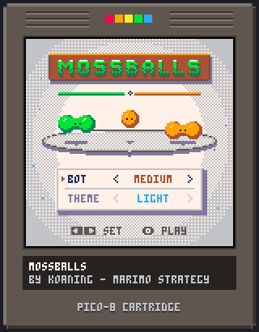
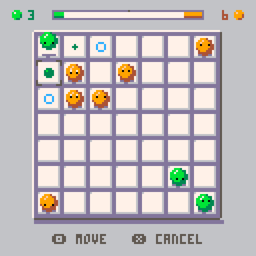

# Mossballs — PICO-8 cart

| Cartridge | Gameplay |
| --- | --- |
|  |  |

```bash
pico8 -run mossballs.p8     # or `make pico8` from the repo root
```

The cart is `mossballs.p8`, which `#include`s:

| File | What |
| --- | --- |
| `board.lua` | board state, cloning, starting layout |
| `rules.lua` | moves, conversion, passing, winner |
| `ai.lua` | easy / medium / hard bot |
| `main.lua` | title menu, 7×7 3D organic blob renderer, animations, HUD, sfx |

Edit the `.lua` files in any editor. PICO-8 picks them up on `run`. To
export a standalone `.p8.png`/HTML, load the cart in PICO-8 and `save` /
`export`; includes get baked in at that point.

## Controls

- Title: ⬆️⬇️ choose bot/theme, ⬅️➡️ change setting, 🅾️ start.
- Game: ⬆️⬇️⬅️➡️ move the cursor, 🅾️ select a spore and then a target, ❎ deselect.
  Dots are grow targets, rings are jump targets.

## Music

Two calm chord loops with no lead melody: "sprout parade" (72 bpm) on the
title screen (pattern 0) and "moss garden" (90 bpm) in game (pattern 4).
Each is a plucked sine harp arpeggio over a bouncy triangle bass. They are
written as chord charts in `tools/music.lua`, which compiles them into
sfx 8+ and the `__music__` section of the cart:

```bash
make music   # rewrite the cart's music data after editing the score
```

`make test` fails if the cart's music data is stale. The cart plays them with
`music(n, fade, 3)`, which reserves channels 0-1 so sfx always have 2-3.
If you edit the music in PICO-8's tracker instead, stop using the score
because `make music` would overwrite those edits.

## Notes

- The bot runs in a coroutine and calls `ai_tick()`, which yields whenever
  the frame's CPU is ~80% used, so the screen keeps animating while it thinks.
- Hard is a 2-ply alpha-beta minimax search.

## Preview player (no PICO-8 needed)

`preview/` is a small PICO-8 stand-in written in LÖVE. It reads
`mossballs.p8`, resolves its `#include`s and runs the cart against a minimal
PICO-8 API: 128×128 framebuffer, the 16-colour palette, shapes, a 3×5 font,
buttons, coroutines, and a tiny synth (`preview/synth.lua`) for the
`__sfx__` and `__music__` sections.

```bash
make pico8-preview && love dist/mossballs-p8.love   # desktop
make serve                                          # browser
```

It counts Lua VM instructions against PICO-8's ~4M/sec budget, so `stat(1)`
and the bot's thinking time are roughly what the real console would give.
Colours, font and sound are approximations. Use real PICO-8 to judge
how the cart looks and sounds.
